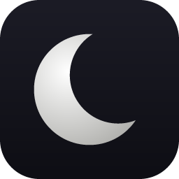
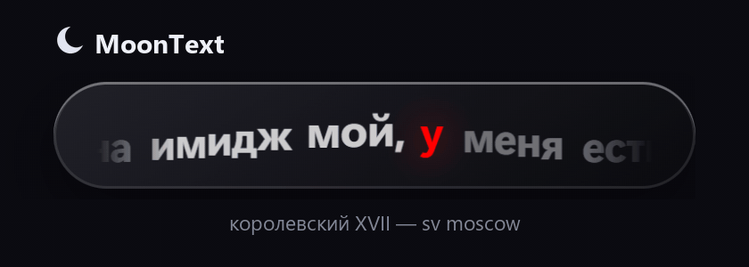
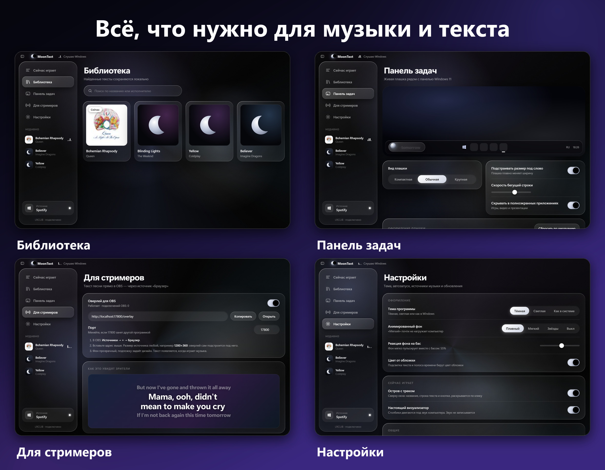
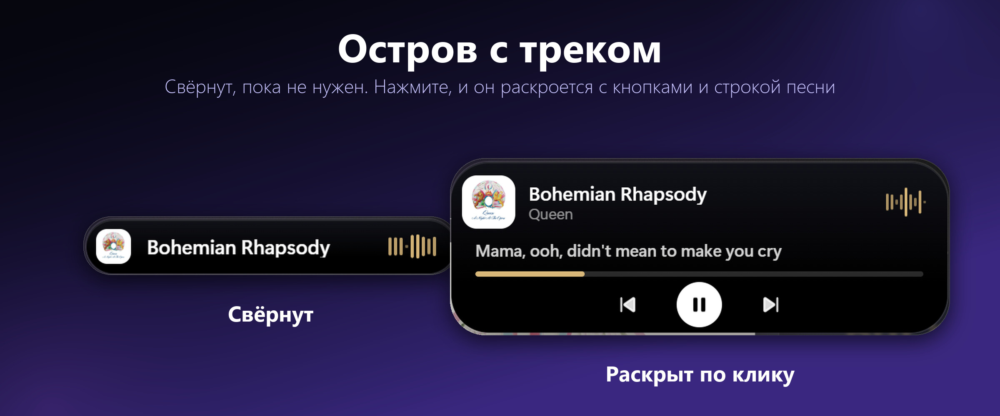
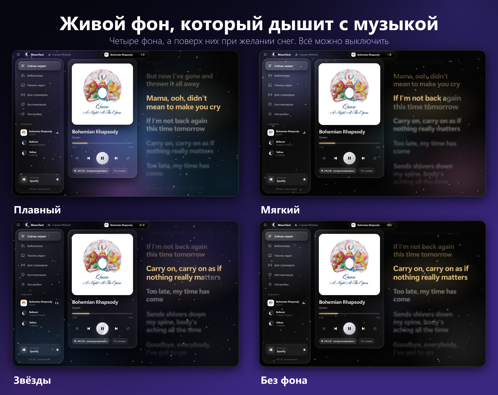
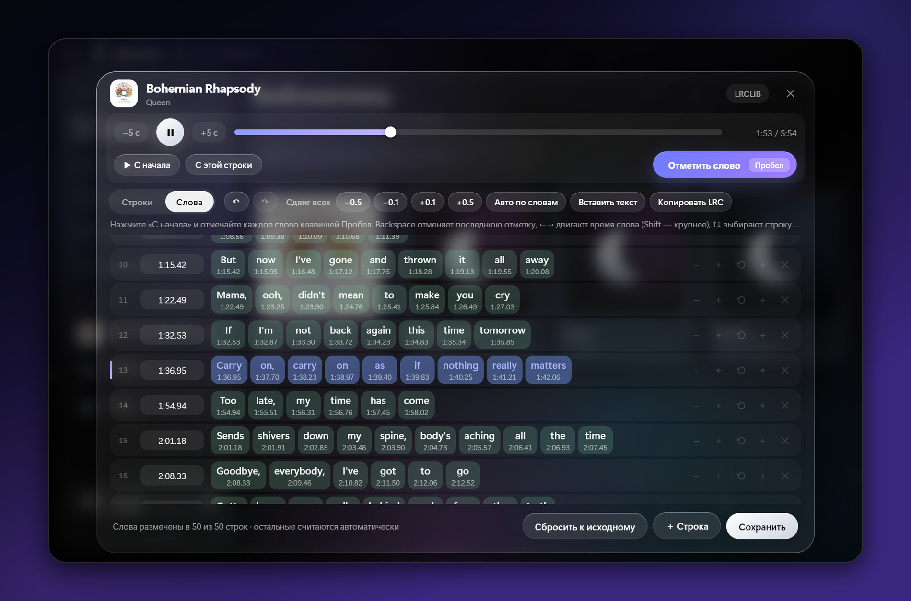
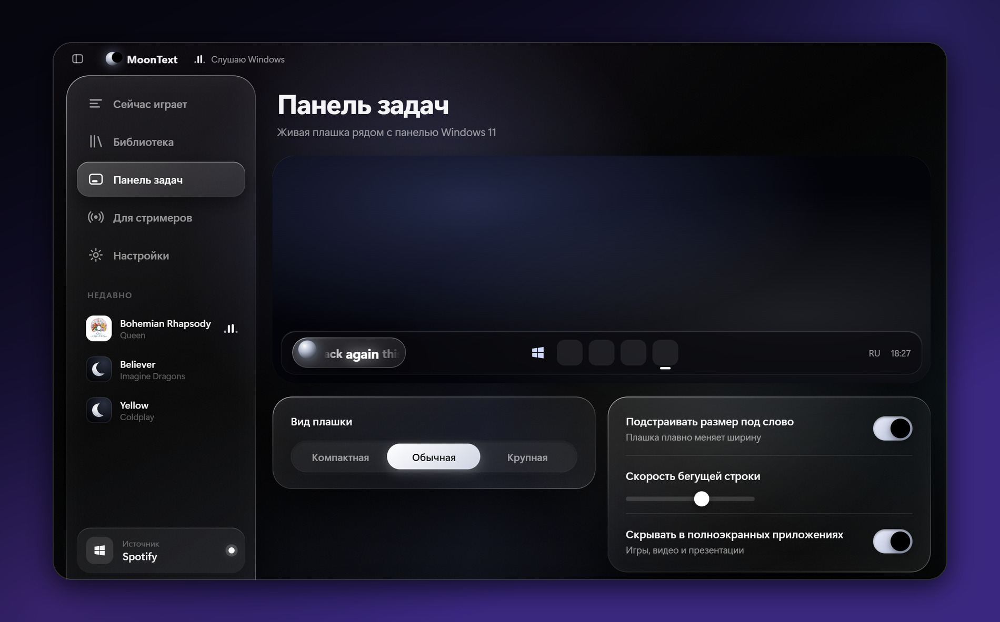
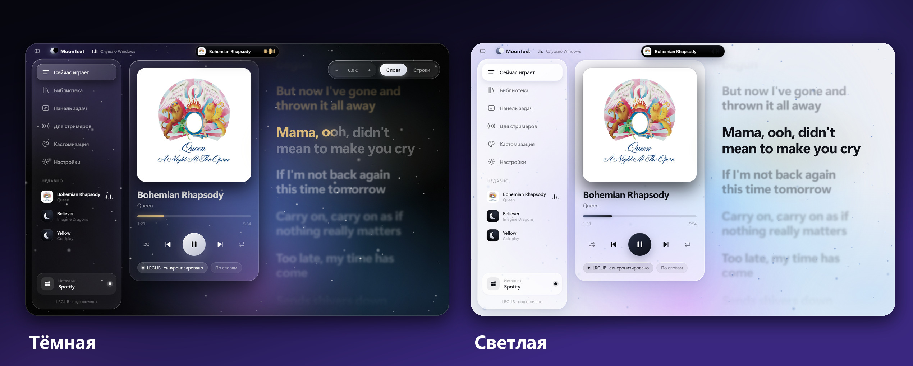

<div align="center">



# MoonText

**Тексты песен по словам — в окне, на панели задач Windows 11 и в OBS**

[](https://github.com/XanorCODE/MoonText/releases/latest)
[](https://github.com/XanorCODE/MoonText/releases)
[](LICENSE)


[**⬇ Скачать**](https://github.com/XanorCODE/MoonText/releases/latest) &nbsp;·&nbsp; [Возможности](#-возможности) &nbsp;·&nbsp; [Для стримеров](#-для-стримеров-obs) &nbsp;·&nbsp; [Вопросы](#-вопросы-и-ответы) &nbsp;·&nbsp; [Telegram](https://t.me/xanorcode)

<br>


</div>

<br>

MoonText смотрит, что играет в системе (Spotify, Яндекс Музыка, YouTube Music, Apple Music, браузер и другие плееры), находит синхронизированный текст в [LRCLIB](https://lrclib.net) и показывает его с подсветкой **каждого слова** в такт песне. Если текста там нет, подставит обычный текст с [Genius](https://genius.com).

<div align="center">



<sub>Плашка рядом с панелью задач</sub>

</div>

## ✨ Возможности

| | |
|---|---|
| 🎵 **Сам находит трек** | Читает системный медиа-сеанс Windows: ничего подключать и настраивать не нужно |
| 🔤 **Подсветка по словам** | Текст идёт строка за строкой, а текущее слово заливается в такт |
| 🏝 **Остров с треком** | Сверху окна: название, строка песни и кнопки; раскрывается по клику |
| 🌌 **Живой фон** | Свет за текстом плавно движется и дышит с громкостью музыки; есть «мягкий» режим, звёзды и выключение, а поверх всего можно включить снег |
| 🎚 **Настоящий визуализатор** | Эквалайзер двигается под реальный звук компьютера; звук не записывается |
| 🎨 **Цвет от обложки** | Подсветка текста и полоса времени берут цвет обложки трека |
| 🖼 **Качественные обложки** | Мелкую или не квадратную обложку из плеера MoonText заменяет чёткой из iTunes; если в сети такой нет, остаётся обложка из плеера |
| ✍️ **Редактор текстов** | Правьте строки и время, размечайте под песню отдельные слова клавишей Пробел, вставляйте и копируйте LRC; ваши правки не затираются |
| ⏱ **Сдвиг под песню** | Текст чуть раньше или позже музыки? Кнопки «−» и «+» над текстом запоминают сдвиг для этой песни |
| 🪟 **Плашка у панели задач** | Компактная плашка со словами рядом с часами, скрывается в полноэкранных приложениях |
| 📺 **Оверлей для OBS** | Готовый источник «Браузер», 12 дизайнов, подстраивается под любой размер |
| 🌗 **Тёмная и светлая тема** | Как в Windows или вручную; по умолчанию строгий чёрный «жидкое стекло» |
| 🖼 **Обложки и библиотека** | Обложки треков, список всех найденных текстов и поиск по ним, всё хранится только у вас на компьютере |
| 🔀 **Свои источники** | Отключите браузер или любой плеер в настройках, и он не будет перебивать нужную музыку |
| 🔄 **Само обновляется** | Берёт новые версии из релизов GitHub; автоскачивание можно выключить галочкой |

<div align="center">



</div>

### Остров и живой фон

Над текстом живёт **остров** с названием трека. Он сжат, пока не нужен, а по клику раскрывается: строка песни, полоса времени и кнопки управления плеером. Волна внутри острова двигается под реальный звук и красится в цвет обложки.

<div align="center">



</div>

Фон за текстом можно выбрать под настроение: **плавный свет**, **мягкий** (почти не нагружает компьютер), **звёздное небо** или без фона. Свет реагирует на громкость музыки: чем громче, тем ярче пятна. Силу реакции можно убавить ползунком. Поверх любого фона можно включить **снег**: лёгкий снегопад, который не мешает читать текст.

<div align="center">



</div>

Всё это включено сразу и настраивается на вкладке **«Кастомизация»**. Когда музыка на паузе или окно свёрнуто, фон и визуализатор засыпают и ничего не тратят.

### Редактор текстов

Нажмите на песню в «Библиотеке» или в «Недавних», и откроется редактор:

- правка текста и времени каждой строки, добавление и удаление строк, **отмена Ctrl+Z**;
- **синхронизация под песню**: пауза, перемотка и «С начала» прямо в редакторе, отметка строки клавишей **Пробел** в момент, когда она начинает звучать;
- **время каждого слова**: отметка вручную, автоматическая раскладка и подсветка по вашим меткам в окне, на плашке и в оверлее;
- вставка текста обычного или в формате LRC, копирование в LRC (с метками слов), сброс к исходному тексту.

Свои правки сохраняются и не перезаписываются из сети. Песню нужно запустить в плеере: MoonText управляет им, но сам музыку не играет.

<div align="center">



</div>

### Плашка рядом с панелью задач

Сначала название трека, потом слова песни. Плашку можно настроить под себя:

- **шесть анимаций текста**: бегущая строка, появление, подъём, увеличение, фокус, заливка;
- эффект **«Волна»**: буквы плавно колышутся, как бегущая волна;
- размер, ширина, прозрачность, скругление, луна и **любой цвет акцента** из палитры;
- **60 кадров в секунду**: слова и заливка двигаются ровно (включено по умолчанию);
- **экономный режим**: без плавных переходов, почти не нагружает компьютер;
- положение на панели (слева, по центру, справа) и отступ от края.

<div align="center">



</div>

### Тёмная и светлая тема

Тема переключается вручную или следует за Windows (вкладка «Кастомизация»). Меню слева можно свернуть в узкую полоску с иконками кнопкой в шапке окна.

<div align="center">



</div>

## 📺 Для стримеров (OBS)

1. В MoonText откройте **«Для стримеров»** и включите оверлей.
2. В OBS: **Источники → + → Браузер**.
3. Вставьте адрес `http://localhost:17800/overlay`. Размер источника любой (например, 1280×360): оверлей сам подстроится под него.

Фон прозрачный, подложку задаёт дизайн, текст появляется, когда играет музыка. Двенадцать дизайнов на выбор:

> Минимал · Стекло · Караоке · Неон · Субтитры · Терминал · Плеер · Капсула · Аврора · Винил · Эквалайзер · **Плашка** (такая же, как на панели задач, с теми же настройками)

Размер текста, шрифт, цвет, число строк, выравнивание, обложку и подложку можно менять в приложении: в OBS всё обновляется на лету. Сервер слушает только `127.0.0.1`, снаружи он недоступен.

## ⬇ Установка

1. Скачайте `MoonText-Setup-X.Y.Z.exe` из [последнего релиза](https://github.com/XanorCODE/MoonText/releases/latest).
2. Запустите установщик: установка идёт в вашу папку пользователя, права администратора не нужны.
3. Включите музыку в любом плеере.

> [!NOTE]
> Установщик пока не подписан, поэтому Windows SmartScreen может показать предупреждение. Нажмите **«Подробнее» → «Выполнить в любом случае»**. Весь исходный код открыт: вы можете проверить его или собрать программу сами.

Обновляться вручную не нужно: MoonText сам найдёт новую версию и предложит поставить её.

## 🔒 Что уходит в сеть

MoonText работает локально. Данные о треке отправляются только туда, где они нужны:

| Куда | Что | Зачем |
|---|---|---|
| `lrclib.net` | название, исполнитель, альбом, длительность | найти синхронизированный текст |
| `genius.com` | исполнитель и название | запасной источник, если в LRCLIB текста нет |
| `itunes.apple.com` | исполнитель и название | обложка, если плеер её не отдаёт или она мелкая |
| `github.com` | запрос на новую версию | проверка обновлений |

Найденные тексты и настройки лежат в папке пользователя на вашем компьютере. Аккаунтов и регистрации нет.

Визуализатору нужен звук компьютера: он читается прямо в программе, обрабатывается в памяти, чтобы нарисовать столбики, и **никуда не сохраняется и не отправляется**. Выключается в **Настройки → Сейчас играет**.

## ❓ Вопросы и ответы

<details>
<summary><b>Текст не находится</b></summary>

<br>

Если текста нет ни в LRCLIB, ни на Genius, плашка покажет «Текст не найден», а под заголовком в окне написано, где искали и что получилось. Проверьте, что название и исполнитель в плеере написаны правильно. Для редких треков тексты появляются не сразу: [LRCLIB](https://lrclib.net) пополняется сообществом.

Если LRCLIB ответил «слишком много запросов», MoonText подождёт и повторит поиск сам.

</details>

<details>
<summary><b>Текст неточный или его нет, как добавить свой</b></summary>

<br>

Нажмите на песню в «Недавних» (или в «Библиотеке», если текст уже сохранён): откроется редактор. Там можно вставить свой текст, поправить строки, а потом отметить время под играющую песню клавишей Пробел.

</details>

<details>
<summary><b>Браузер перебивает мой плеер</b></summary>

<br>

В **Настройки → Источники музыки** выключите переключатель у браузера. MoonText перестанет его слушать и будет показывать текст из плеера.

</details>

<details>
<summary><b>Текст идёт чуть раньше или позже музыки</b></summary>

<br>

Для одной песни: на вкладке «Сейчас играет» над текстом нажимайте «−» и «+». Сдвиг запомнится именно для этой песни и сработает в окне, на плашке и в оверлее.

Для всех песен сразу: **Настройки → Тексты → Сдвиг синхронизации**.

</details>

<details>
<summary><b>Плашка не появляется</b></summary>

<br>

Плашка показывается, пока играет музыка. Проверьте переключатель **«Плашка на панели задач»** на вкладке «Панель задач». Если открыто полноэкранное приложение или игра, плашка скрыта специально: это можно отключить на вкладке «Панель задач».

</details>

<details>
<summary><b>Не хочу остров, анимированный фон, снег или визуализатор</b></summary>

<br>

Всё выключается на вкладке **«Кастомизация»**: фон («Выкл» или «Мягкий» для самого лёгкого), снег, реакция фона на громкость, цвет от обложки, качественные обложки, остров и настоящий визуализатор.

</details>

<details>
<summary><b>Хочу, чтобы обновления не скачивались сами</b></summary>

<br>

В **Настройки → Общие** выключите **«Скачивать обновления автоматически»**. MoonText только сообщит о новой версии, а скачать её можно кнопкой в левом меню.

</details>

<details>
<summary><b>Компьютер заметно нагружается</b></summary>

<br>

На вкладке **«Панель задач»** включите **«Экономный режим»**: плашка перестанет плавно двигаться и почти ничего не потребляет. Ещё легче станет, если выключить снег и выбрать фон «Мягкий» или «Выкл» на вкладке «Кастомизация», а в «Оформлении плашки» отключить «60 кадров в секунду».

</details>

## 🛠 Для разработчиков

```bash
npm install
npm start
```

Без плеера интерфейс можно проверить на тестовом треке: `MOONTEXT_FAKE=1 npm start`.

Хотите помочь проекту? Как сообщить об ошибке, предложить идею и отправить pull request, написано в [CONTRIBUTING.md](CONTRIBUTING.md). Нашли ошибку в программе? Нажмите **«Сообщить о проблеме»** в «Настройки → О программе»: версия, трек и журнал скопируются в буфер, останется вставить их в issue.

Собрать установщик (появится в `dist/`):

```bash
npm run dist
```

<details>
<summary><b>Как выпустить версию</b></summary>

<br>

1. Поднять `version` в `package.json` и добавить запись в `src/changelog.js`.
2. Собрать установщик: `npm run dist`.
3. Создать релиз с тремя файлами из `dist/`: `MoonText-Setup-X.Y.Z.exe`, `MoonText-Setup-X.Y.Z.exe.blockmap` и `latest.yml`.

Адрес репозитория для автообновления задан в `package.json` → `build.publish` (`owner` / `repo`).

</details>

## 📄 Лицензия

[MIT](LICENSE) © 2026 XanorCODE

## 👤 Автор

Программа сделана **XanorCODE**.

[](https://t.me/xanorcode)
[](https://github.com/XanorCODE)

---

<sub>**English:** MoonText is a free Windows app that shows synced lyrics word by word, in its own window, in a pill next to the Windows 11 taskbar and as an OBS overlay. It reads the current track from Windows, fetches lyrics from [LRCLIB](https://lrclib.net) (with [Genius](https://genius.com) as a plain-text fallback) and updates itself from GitHub Releases. It also has a track island, an animated background that follows the loudness (with optional snow), a real audio visualizer and cover-based accent colors. Download the installer from the [latest release](https://github.com/XanorCODE/MoonText/releases/latest). MIT licensed.</sub>
