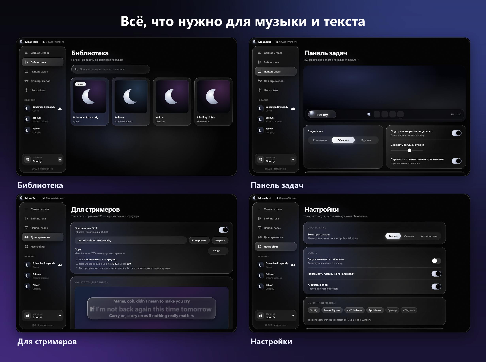
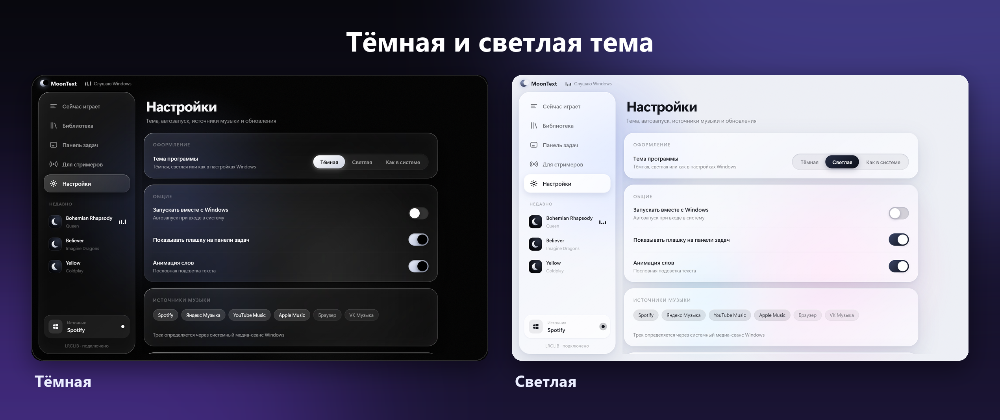

# MoonText

Синхронизированные тексты песен для Windows. MoonText смотрит, что играет в системе (Spotify, Яндекс Музыка, браузер и др.), находит текст в [LRCLIB](https://lrclib.net) и показывает его с пословной подсветкой — в окне и в плашке рядом с панелью задач Windows 11.

<p align="center"></p>

## Возможности

Тексты ищутся в [LRCLIB](https://lrclib.net) (с подсветкой по словам). Если там текста нет, MoonText показывает обычный текст с [Genius](https://genius.com) — без синхронизации.

<p align="center"></p>

### Плашка рядом с панелью задач

Название трека, затем текст по словам. Шесть анимаций, эффект «Волна», экономный режим и скрытие в полноэкранных приложениях.

<p align="center"></p>

### Тёмная и светлая тема

<p align="center"></p>

## Для стримеров (OBS)

«Для стримеров» → включить оверлей → в OBS добавить источник **Браузер** с адресом `http://localhost:17800/overlay`, ширина 1280, высота 360. Двенадцать дизайнов (Минимал, Стекло, Караоке, Неон, Субтитры, Терминал, Плеер, Капсула, Аврора, Винил, Эквалайзер и «Плашка» — такая же, как на панели задач, с теми же настройками), размер, шрифт, цвет, число строк и подложка настраиваются в приложении и меняются в OBS на лету. Сервер слушает только `127.0.0.1`.

## Запуск из исходников

```bash
npm install
npm start
```

Без плеера можно проверить интерфейс на тестовом треке: `MOONTEXT_FAKE=1 npm start`.

## Сборка

```bash
npm run dist
```

Установщик появится в `dist/`.

## Релизы и обновления

Приложение проверяет последний релиз на GitHub (Настройки → О программе) и обновляется само.
Чтобы выпустить версию:

1. Поднять `version` в `package.json` (и добавить запись в `src/changelog.js`).
2. Собрать установщик: `npm run dist`.
3. Создать релиз с тремя файлами из `dist/`: `MoonText-Setup-X.Y.Z.exe`, `MoonText-Setup-X.Y.Z.exe.blockmap` и `latest.yml`.

Адрес репозитория для автообновления задан в `package.json` → `build.publish` (`owner` / `repo`).

## Автор

Программа сделана **XanorCODE** — Telegram: [t.me/xanorcode](https://t.me/xanorcode), GitHub: [github.com/XanorCODE](https://github.com/XanorCODE).
